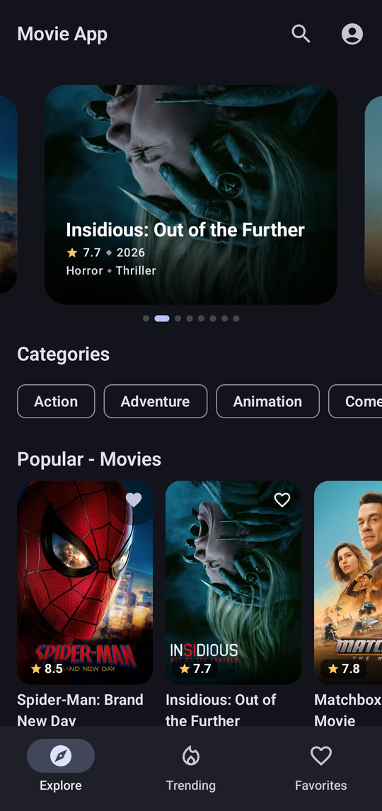
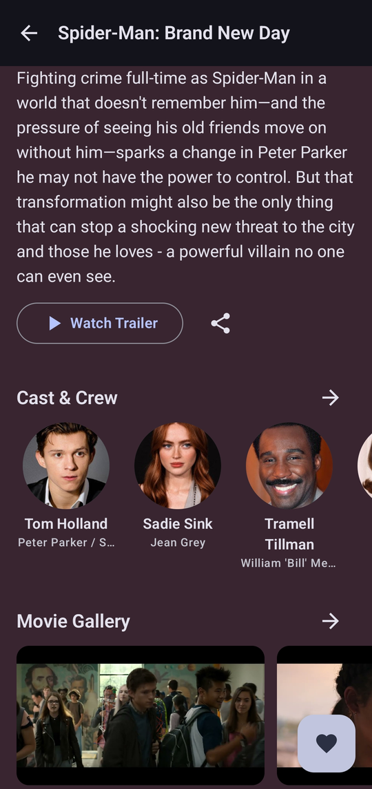
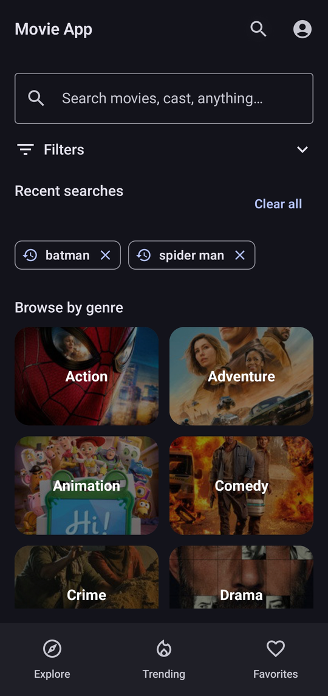
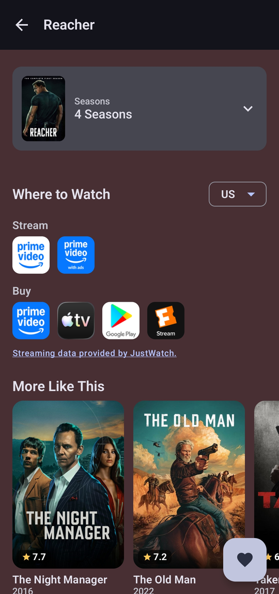

# movieAppKotlin

An offline-first Android app for browsing movies and TV shows, built with Kotlin and Jetpack Compose on top of the [TMDB](https://www.themoviedb.org/) API.

> Originally a small MVVM + Retrofit demo, the app has since been rewritten from scratch in Jetpack Compose with a Room-backed offline cache, Paging 3, Hilt and a full TV Shows experience.

<p align="center">
 
 
 
 
</p>

## Features

- **Explore**: hero carousel, genre chips and nine curated sections (popular, action, sci-fi, upcoming, top rated and trending across movies and TV).
- **Trending and Genres**: infinite scrolling lists for movies and TV, one screen per genre.
- **Search**: explicit-submit search over movies, TV shows and people, recent-search chips, list / grid / dense-grid views, and Year / Language / Rating / Genre filters. A separate filter panel uses TMDB Discover for movies and TV.
- **Movie and TV detail**: information, cast and crew, similar and recommended titles, collections, seasons and episodes (TV), "Where to watch" by region, an in-app trailer player and a photo gallery with a pinch-to-zoom viewer.
- **Person screen**: biography and a filterable filmography (Movies / TV, Actor / Director).
- **Favorites**: Movies and TV tabs, stored locally with a composite `(id, mediaType)` key so a TV id never collides with a movie id.
- **Loading states**: skeleton shimmer placeholders across the app, including poster images, that respect dark theme and the system animation setting.
- **Offline-first caching**: Room cache with a 2-hour staleness window, a periodic background sync, and a 10 MB OkHttp HTTP cache that honours TMDB's cache headers.

## Tech stack

| Area | Libraries |
|---|---|
| Language / UI | Kotlin, Jetpack Compose, Navigation Compose, Coil |
| Architecture | MVVM, repository pattern, `NetworkBoundResource`, Kotlin Coroutines and Flow |
| Dependency injection | Hilt |
| Local storage | Room (schema v8, exported schemas and real migrations) |
| Networking | Retrofit, OkHttp (timeouts, retry interceptor, HTTP cache) |
| Pagination | Paging 3 with Room-backed `RemoteMediator`s |
| Background work | WorkManager |

## Architecture

```
data/remote/      TMDB Retrofit API + DTOs
data/local/       Room database: movies, TV, favorites, search history, Discover cache
data/mapper/      DTO <-> Entity <-> domain model
data/repository/  Offline-first repositories
data/paging/      RemoteMediators (Room-backed) and network-only PagingSources
domain/model/     Movie, MovieDetails, TvShowDetails, Person, DiscoverFilters, ...
di/               Hilt modules (Network / Database / Preferences / Repository)
util/             NetworkBoundResource, NetworkErrors, Resource, helpers
work/             SyncWorker (periodic cache refresh)
ui/               One package per screen, plus shared components and navigation
```

## Engineering notes

- **Safe database migrations**: destructive fallback is enabled in debug builds only. A release build with a schema change and no `Migration` fails loudly instead of silently wiping a user's Favorites.
- **Paging pitfalls**: live side flows (such as favorites) are never combined with a `Flow<PagingData>`. They are snapshotted inside `PagingSource.load()`, and TMDB pages are de-duplicated per source instance.
- **Trailer player**: the YouTube IFrame player runs in a `WebView` hosted on a real navigation destination rather than a `Dialog`, so orientation and fullscreen changes are safe. The player is kept as a single composable call site so the `WebView` is not recreated on every toggle.
- **Real photo gallery**: it uses real episode stills (TV) and screened trailer frames (movies), de-duplicated with a perceptual hash.

## Getting started

1. Clone the repo:
   ```bash
   git clone https://github.com/Ahsan-86/movieAppKotlin.git
   ```
2. Get a free API key from [TMDB](https://www.themoviedb.org/settings/api). Use the **API Key (v3 auth)** value, not the Read Access Token.
3. Add your key to `local.properties` in the project root (the file is gitignored). You can copy `local.properties.example` to `local.properties` and fill it in:
   ```properties
   TMDB_API_KEY=your_tmdb_api_key_here
   ```
   Alternatively, set a `TMDB_API_KEY` environment variable. The build reads `local.properties` first and falls back to the environment variable. The key is injected as `BuildConfig.TMDB_API_KEY`, so it never lives in source.
4. Open the project in Android Studio, let Gradle sync, and run the `app` configuration.

Without a key the app builds, but every network request will fail.

### Requirements

| Item | Version |
|---|---|
| Android Studio | Meerkat (2024.3.1) or newer, required by Android Gradle Plugin 8.9.2 |
| JDK | 17 (the JDK bundled with Android Studio works) |
| Gradle | 8.11.1, provided by the included wrapper |
| Kotlin | 2.0.21 |
| `minSdk` | 24 (Android 7.0) |
| `targetSdk` / `compileSdk` | 36 |

## Roadmap

- Scroll-performance tuning
- Deeper TV episode interaction
- Cloud-synced favorites (Firebase)

## Attribution

This product uses the TMDB API but is not endorsed or certified by TMDB. Streaming availability data is provided by JustWatch via TMDB.
